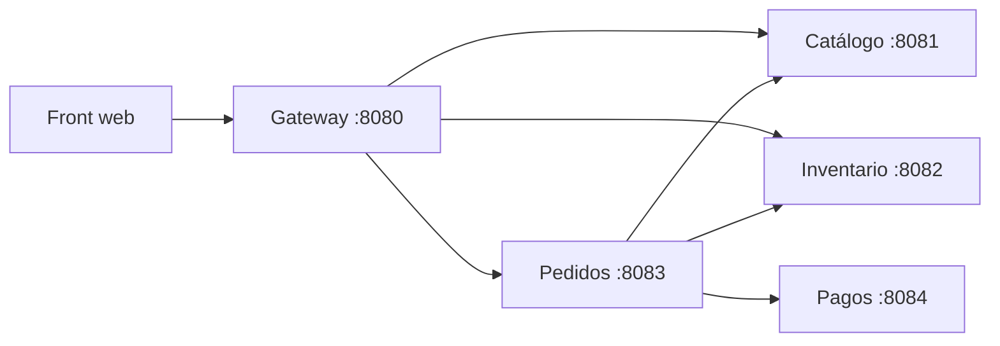

# Almacén con microservicios

El almacén de una tienda dividido en servicios pequeños, cada uno con una sola responsabilidad, sus propios datos y su propio proceso. Se comunican solo por HTTP con JSON. Un gateway es la única puerta de entrada y sirve un front web que habla con los servicios reales.



| Servicio | Puerto | Responsabilidad | Datos que guarda |
|---|---|---|---|
| Gateway | 8080 | Única entrada para el navegador. Sirve el front, reparte las peticiones y junta catálogo con inventario. | Ninguno |
| Catálogo | 8081 | Qué productos existen y su precio. | Productos |
| Inventario | 8082 | Cuántas unidades hay. Reserva, libera y confirma mercancía. | Existencias y reservas |
| Pedidos | 8083 | Coordina cada compra entre los demás servicios. | Pedidos y su historial de pasos |
| Pagos | 8084 | Aprueba o rechaza el cobro (límite de 100 MXN por compra). | Pagos |

## Cómo correrlo

Requisito: Node.js 18 o más reciente. No hay dependencias externas.

```bash
npm start
```

Levanta los cinco servicios. Abre **http://127.0.0.1:8080** en el navegador. En PowerShell, si aparece el error de "ejecución de scripts deshabilitada", usa `npm.cmd start`.

También se puede levantar cada servicio por separado, en su propia terminal, para apagar uno y ver cómo responde el resto:

```bash
npm run start:catalogo
npm run start:inventario
npm run start:pagos
npm run start:pedidos
npm run start:gateway
```

Las direcciones entre servicios se pueden cambiar con las variables `CATALOGO_URL`, `INVENTARIO_URL`, `PEDIDOS_URL` y `PAGOS_URL`, el puerto con `PORT` y la interfaz con `HOST`, por ejemplo para desplegarlos en servidores distintos.

## Cómo se hace una compra

El servicio de pedidos sigue estos pasos y, si alguno falla, deshace los anteriores en lugar de bloquear a todos (patrón saga):

1. Pregunta al catálogo si el producto existe y su precio.
2. Pide al inventario que reserve las unidades.
3. Pide a pagos que cobre.
4. Si el cobro se aprueba, confirma la reserva. Si se rechaza o pagos no está disponible, libera la reserva.

| Estado del pedido | Código | Cuándo pasa |
|---|---|---|
| `CONFIRMADO` | 201 | Hubo stock y el pago se aprobó. |
| `RECHAZADO_SIN_STOCK` | 409 | No había unidades suficientes. |
| `PAGO_RECHAZADO` | 402 | El cobro se rechazó; la reserva se liberó. |
| `FALLIDO` | 503 | Inventario o pagos no estaban disponibles; si había reserva, se liberó. |
| `PENDIENTE` | 202 | Pagos no respondió a tiempo y no se sabe si cobró; la reserva se mantiene. |

Cada petición lleva una cabecera `x-request-id` que se pasa de servicio en servicio, así que en la consola se puede seguir una compra completa por todos los servicios. `POST /api/pedidos` acepta `Idempotency-Key` para reintentar sin duplicar el pedido.

## API del gateway

| Método y ruta | Qué hace |
|---|---|
| `GET /` | Front web. |
| `GET /api/salud` | Estado de cada servicio. |
| `GET /api/productos` | Catálogo con existencias (si inventario no responde, llega sin existencias). |
| `POST /api/pedidos` | Crea un pedido: `{"producto":"peras","cantidad":2,"cliente":"Ana"}`. |
| `GET /api/pedidos` | Últimos pedidos. |
| `GET /api/pedidos/{id}` | Un pedido con sus pasos. |

```bash
curl -X POST http://127.0.0.1:8080/api/pedidos -H "Content-Type: application/json" -d "{\"producto\":\"peras\",\"cantidad\":2,\"cliente\":\"Ana\"}"
```

## Estructura

| Ruta | Contenido |
|---|---|
| `microservicios/iniciar.js` | Levanta los cinco servicios con un solo comando. |
| `microservicios/config.js` | Puertos y direcciones de cada servicio. |
| `microservicios/lib/http.js` | Base común: servidor HTTP, rutas, errores y llamadas entre servicios con tiempo de espera. |
| `microservicios/<servicio>/index.js` | Cada servicio. |
| `microservicios/gateway/public/` | El front web. |
| `src/` | Semáforo e inventario que usa el servicio de inventario. |
| `version-pwa.zip` | La versión anterior: tres servidores REST y su simulador como PWA, completa y lista para descomprimir. |

Las versiones anteriores también están en las etiquetas `v1.0-simulador` y `v2.0-pwa`.

## Limitaciones

Cada servicio guarda sus datos en memoria, así que al reiniciarse vuelve a su estado inicial. Los pedidos en estado `PENDIENTE` no se revisan solos. No hay autenticación.
